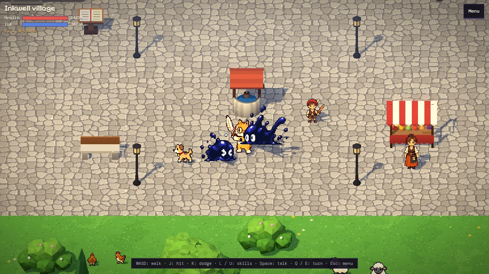
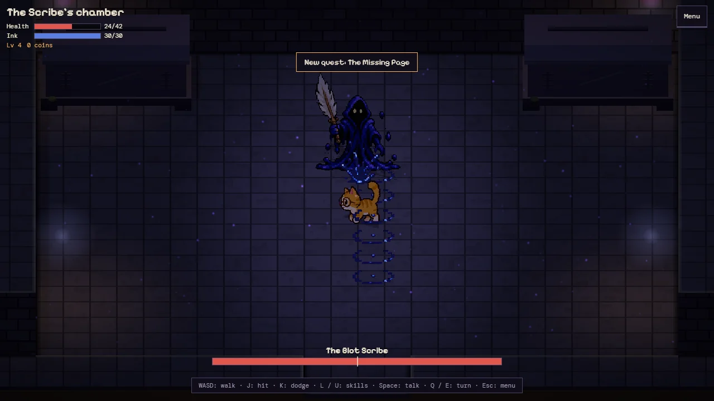
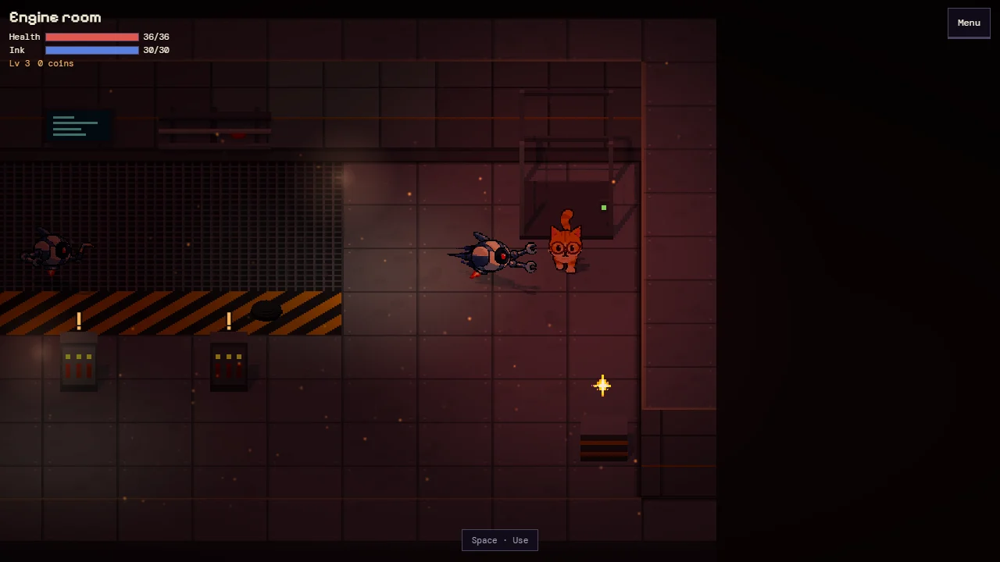
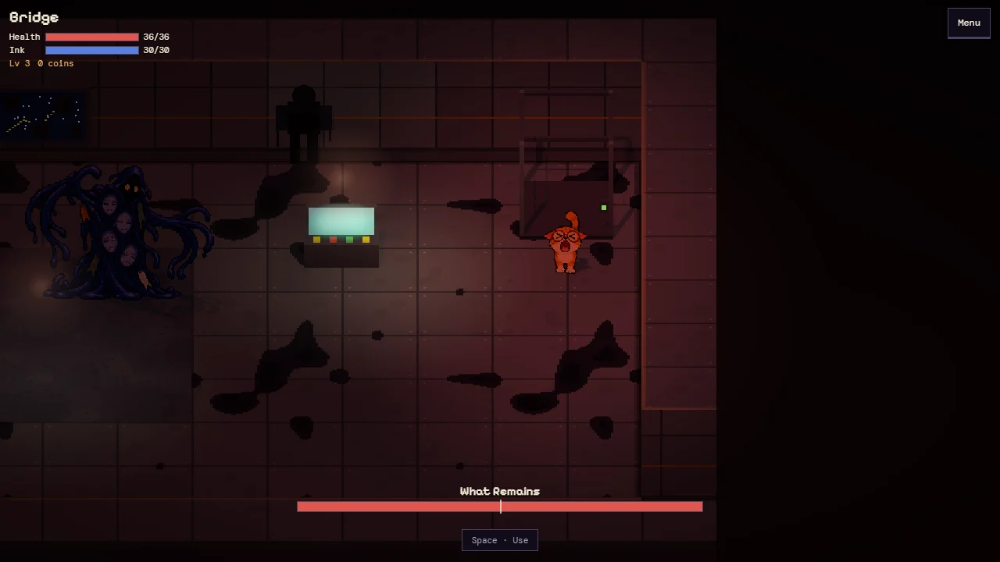
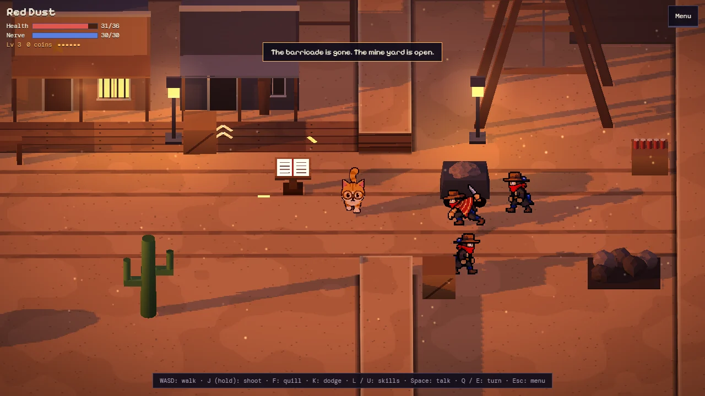
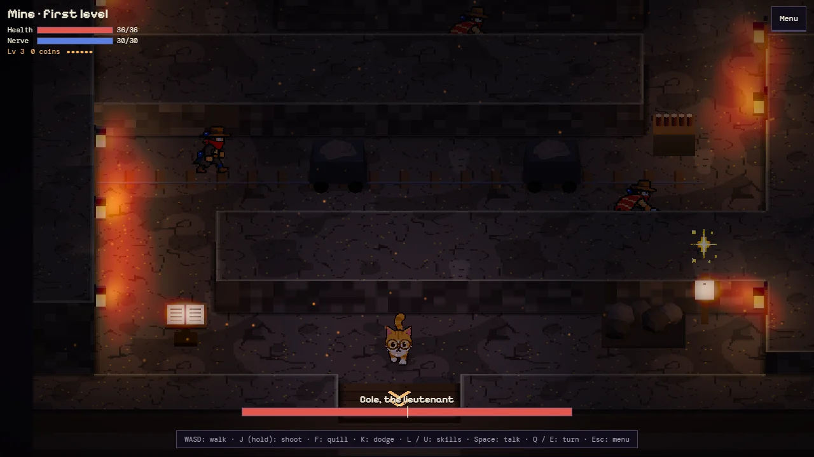
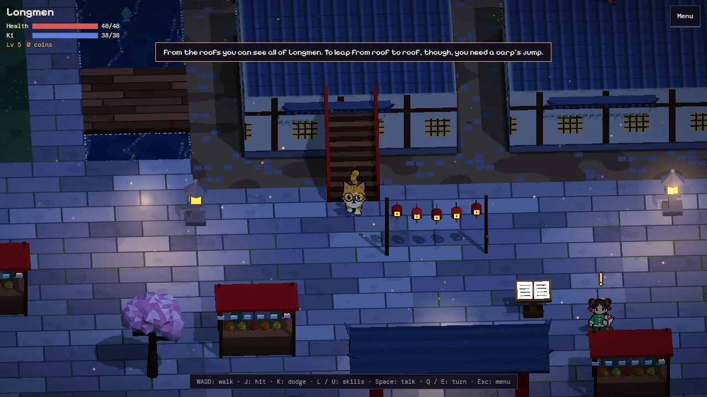
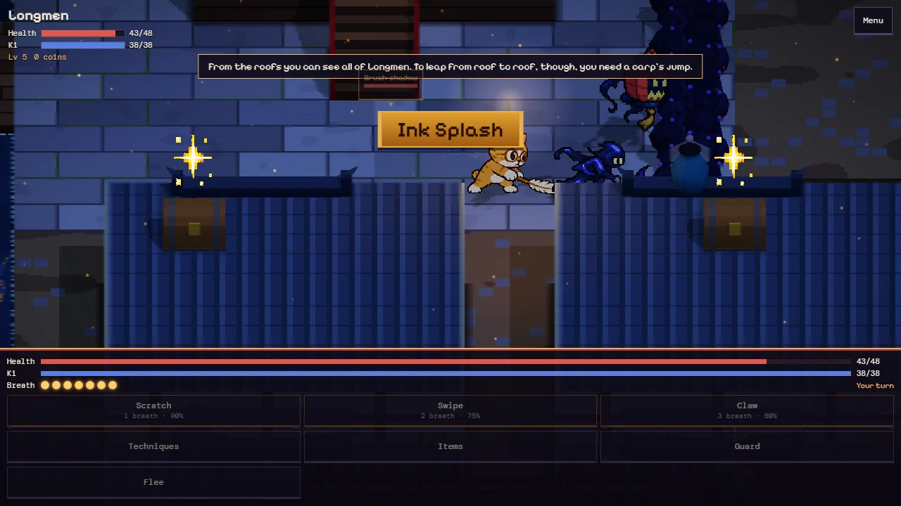
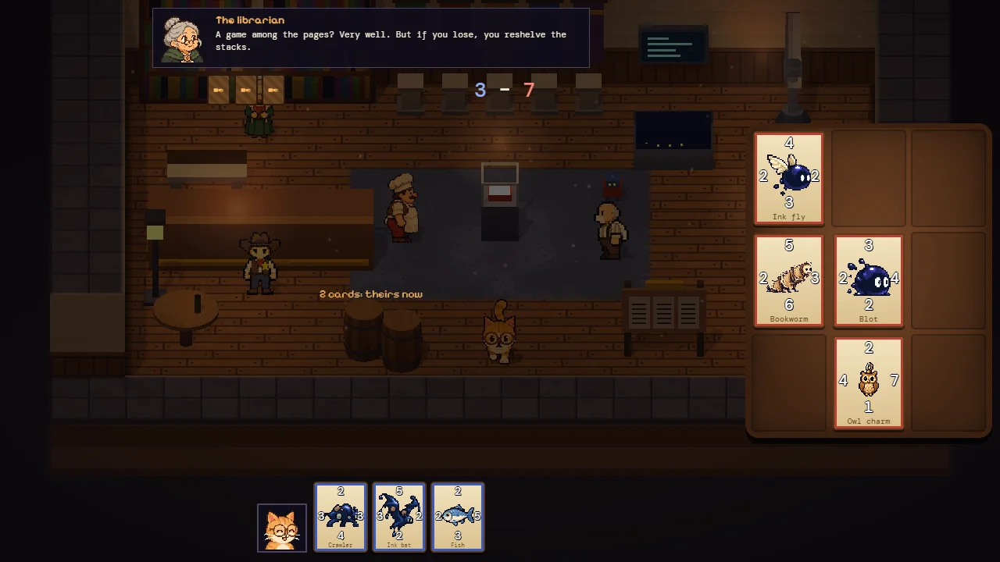

# The Scholar Cat

A small retro action-RPG in a 2.5D pixel world, in four chapters. Folio, the library cat, follows the ink wherever
it spills: out of a torn codex in a village library, aboard a silent starship, down a mine under a frontier town, up
the pagodas of a river city on the night of the lantern festival. Between chapters, a card tourney against the people
met on the way.

**Play it at [martindavinci.github.io/mdv-demo-rpg-cat](https://martindavinci.github.io/mdv-demo-rpg-cat/)**

In English and Italian. On a computer with a keyboard or a gamepad, and on a phone with touch controls. Each chapter
is a story of its own, twenty to thirty-five minutes long; pick any of them under **Chapters** on the title
screen.

## Chapter 1 · The Missing Page

After a night storm, page 7 of the library's old codex is torn into three pieces, and where its ink drips, creatures
crawl out of the blots. Folio takes up a quill and goes after the pieces.

<table>
<tr>
<td width="50%"></td>
<td width="50%"></td>
</tr>
</table>

- An open village ringed by cliffs: the square, the church, the road past the vineyards to the windmill, a pond, a
  fenced garden; the library, the bakery and the crypt under the church.
- A quill combo of three swings, a dodge, and two ink skills learned on the way: **Ink dash**, through enemies and
  over ink pools, and **Inkwell**, a splash that slows everything around.
- Four kinds of inky creatures and the Blot Scribe, a boss in two phases. Every attack is announced: a Blot squashes
  flat before it hops, an Inkfly shivers before it dives, ink marks appear on the floor before they burst.
- A statue that asks a riddle, a crypt with three levers, a shop, two side quests.

## Chapter 2 · The Star Map

Deep space. The ship's mind wakes the cat early from a cryo pod: the Ark is silent, its crew is gone, and the last 41
days are missing from the log.

<table>
<tr>
<td width="50%"></td>
<td width="50%"></td>
</tr>
</table>

- Twelve rooms of a starship: cryo bay, crew quarters, captain's cabin, infirmary, greenhouse, archive, engine room,
  bridge, observatory and more.
- The **Scanner**, a third skill that shows the traces the crew left behind; keypad codes, a breaker puzzle in the
  engine room, four pieces of a star map to put back together.
- Shadows and drones, and at the end What Remains; a choice on the bridge between trusting the captain or the ship.

## Chapter 3 · Red Dust

The old West. The stagecoach barely stops: a mining town at sunset, not a sound in it, and nobody came back from the
mine.

<table>
<tr>
<td width="50%"></td>
<td width="50%"></td>
</tr>
</table>

- The sheriff's revolver: six rounds, held down to fire, reloading by itself; the **Fan** empties it in a spread.
  The quill moves to its own key, and ink becomes **Nerve**.
- The town, the saloon, the sheriff's office, the undertaker's house, then the mine level by level: lanterns,
  flooded tunnels, dynamite for a collapse.
- Gunmen, knifers, dynamiters and the creatures of the vein; Cole the lieutenant and the Ink Outlaw.

## Chapter 4 · The Night of Lanterns

Longmen, the Dragon Gate. On the night of the lantern festival the lanterns are going out, and the ink is climbing the
river.

<table>
<tr>
<td width="50%"></td>
<td width="50%"></td>
</tr>
</table>

- Fights in turns: a blow on the map starts one with the cat first and the foe stunned, a foe's strike starts it with
  the foes first. Blows that spend breath, techniques that spend Ki, items, a guard, and a timed parry: tap as the
  ring closes on the cat.
- Three pagodas climbed floor by floor, each a dojo with its master: Master Bo, Lady Hua, the Black Brush. Each teaches
  a technique: the Carp Leap carries the cat from roof to roof, Lantern Fire burns the ink brambles, the Silk Ribbon
  lets it slide down the ropes.
- Three seal lanterns to light, a kite to find for Mei, and the Ink Dragon at the Gate. Ten levels, gear and loot
  around the city.

## The Tourney

The title's **Tourney** opens a hall where the cat plays cards against the people of the chapters: the librarian, the
ship's mind at her console, Deputy Billy, the baker and Old Abe. Five cards a hand, a board of three by three: a card
laid beside the opponent's takes it when its touching side is higher. Each win takes one of the opponent's cards; the
album keeps 39 of them, and each finished chapter adds its boss.

## New game+

A chapter finished in this browser offers **New game+**, on the title screen and on its card under **Chapters**: the
chapter starts again from the beginning, and the cat keeps its level and experience, its coins, its gear and the
things it carries to use. The key items and the skills come back the way the story hands them out, and the enemies
are as strong as the first time.

## Difficulty

**Difficulty**, under **Options** on the title screen and in the menu, sets how hard the fights are, for every
chapter, and can be changed at any time, even in the middle of a battle: **Story** (the cat hits harder and takes half
the damage), **Normal** (the game as it was tuned, the default) or **Hard** (the cat hits a little softer and takes
half as much again).

## Controls

| | Keyboard | Gamepad | Phone |
| --- | --- | --- | --- |
| Walk | WASD or arrows | left stick | stick, bottom left |
| Hit (and talk) | J or Z (held: fire, Chapter 3) | A | **Hit** — it reads **Talk** next to someone |
| Dodge | K, X or Shift | B | **Dodge** |
| Skills | L or C / U or V / I or B | X / Y / LT | **Dash**, **Well** (**Fan**), **Scan**, once learned |
| Quill (Chapter 3) | F | RT | **Quill** |
| Talk, open, read | Space or Enter | A | **Talk** |
| Turn the view | Q / E, or drag | shoulder buttons | drag the scene |
| Menu | Esc or Tab | Start | **Menu**, top right |

In a battle (Chapter 4): the menu is tapped on a phone; with keys, the arrows move between its buttons and Space or
Enter presses one; with a gamepad, the shoulder buttons move, A presses, B goes back. During a foe's move, the same key
or a tap anywhere parries.

## Saving

Each chapter keeps its own save in this browser, made when you change area and when a quest moves on; reading at a
reading desk saves too. **Menu → Save code** shows the whole save as a code of letters and digits: paste it into
**Load code** on the title screen of any browser to carry on there, in the chapter it came from. A code with a wrong or
missing letter is refused, not half-loaded.

Options (language, difficulty, frame rate, music, effects, screen shake, atmosphere, shadows) are kept in the browser apart from
the saves.

## Privacy

The game runs entirely in your browser. It makes no network requests after the page has loaded, has no account,
no analytics and no ads. The saves, the cards and the options stay in this browser's storage; nothing is sent
anywhere.

## How it is made

- The world is modelled in code as low-poly shapes, painted with pixel textures, and drawn at a low resolution with
  hard pixels in WebGL with [three.js](https://threejs.org/); the characters, enemies and portraits are pixel-art
  sprites.
- The pixel art was generated with ChatGPT from written prompts, then cleaned, cut, resampled to one pixel grid and
  given depth by a small pipeline written for this game. The title picture is one of those images.
- The chapters are data: places, people, quests, enemies and events, read by one engine.
- The music and the sound effects are made in code at runtime: two pulse voices, a triangle and noise, like an old
  console.
- Everything ships as a few static files; it also runs from a downloaded copy opened as a local file.

## License

The code is under the MIT License (see [LICENSE](LICENSE)). three.js is © its authors, MIT. The fonts Pixelify
Sans and DM Mono are under the SIL Open Font License.
